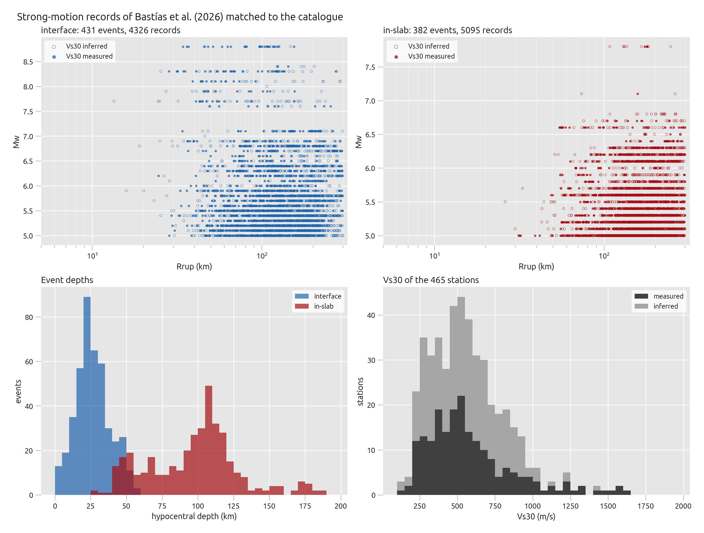
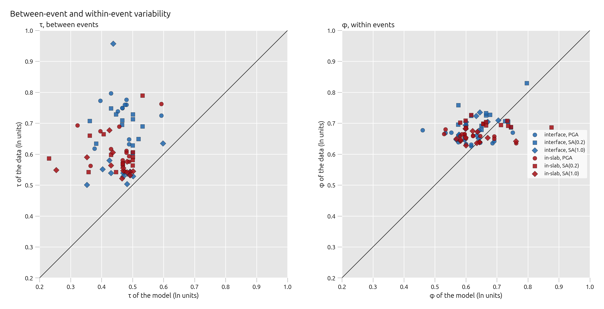
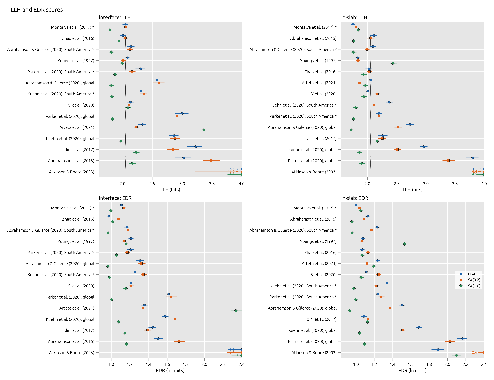

# GM1: residuals of the subduction GMMs on the Bastías et al. (2026) database

15 Nov 2026. Task brief `tasks/GM1_gmm_residuals.md`; data notes `gmm/NOTES_data.md`. Evidence only: nothing here changes the logic tree, and no weights are proposed.

Code: `gmm/records.py` (record table), `gmm/screen.py` (screening), `gmm/residuals.py`, `gmm/scores.py`, entry script `gmm/gm1_run.py`, figures `gmm/gm1_figs.py`, tests `gmm/tests/`. OpenQuake **3.27.0** from the `psha_renta` environment (CLAUDE.md says 3.26; the installed engine reports 3.27.0). The whole run takes about 6 minutes.

**In short** (figures in section 10, handoff note `gmm/SUMMARY_GM1.md`):
- **Best fit:** the Chilean models (Montalva et al. 2016 and 2017) fit the 9 421 records best in both classes, with Zhao et al. (2006, 2016) close on the interface.
- **NGA-Sub, South America versions (current tree):** they predict too low at short periods by a factor of about 1.35–2 and are near zero bias at 1 s. On the Mw ≥ 6.5 events they score best.
- **Too high:** Idini et al. (2017) and Youngs et al. (1997) predict too high.
- **Variability:** the event-to-event scatter of the data (τ) is larger than the models assume; the station-to-station scatter (φ) agrees.

## 1. Data and selection

Inputs: the three flatfiles of Bastías et al. (2026), read in place from `data/ground_motion/` (repo root). Copying them into `psha_chile8/data/ground_motion/` as dated files was blocked in this session, so the copy, `.gitignore` and `SHA256SUMS` lines are left as commands for Pablo (WORKLOG). The checksums of the files read, and the rows for DATA.md, FIGURES.md and REFERENCES.md, are in `gmm/APPENDS_GM1.md`. The frozen catalogue is `catalog/frozen/2026-11-14/catalog_2026-11-14c.csv`.

Matching to the catalogue: nearest in time within ± 90 s and 150 km, then ± 330 s, 50 km and |ΔMw| ≤ 0.3 for the rest. 6 672 of 6 679 flatfile events are matched: 797 by the first pass, 16 by the second (selected events). The 7 left (Mw 3.9–5.5, 11 records) are in `tables/unmatched_events.csv`.

Duplicates: 11 catalogue events carry two flatfile entries about 300 s apart (`tables/duplicate_pairs.csv`). Each station is taken once, from the entry closest in time to the catalogue origin, and 23 records are dropped. The twelfth pair of NOTES_data.md (20101219204805 / 205303) is not merged. Its first entry matches a catalogue Mw 4.5 crustal event; its second entry fails the second-pass Mw test (5.1 against 4.5) and is unmatched. Neither enters the selection.

Mw check: 22 events with |Mw flatfile − Mw catalogue| ≥ 0.5 and one side ≥ 5.5 are dropped and listed in `tables/review_mw.csv` (213 records). They include the four coda aftershocks of Iquique 2014 and Illapel 2015. With the threshold at 5.0 instead of 5.5 the list would hold 79 events.

| step | class | events | records |
|---|---|---|---|
| flatfile | all | 6 679 | 43 050 |
| matched to the catalogue | all | 6 672 | 43 040 |
| after merging duplicate entries | all | 6 488 | 43 017 |
| Mw review (22 events out) | all | 6 466 | 42 804 |
| interface or in-slab | interface / in-slab | 1 841 / 3 363 | 10 588 / 26 043 |
| Mw ≥ 5.0 | interface / in-slab | 434 / 444 | 4 609 / 6 409 |
| Rrup ≤ 300 km | interface / in-slab | 431 / 382 | 4 326 / 5 095 |
| RotD50 present | interface / in-slab | 431 / 382 | 4 326 / 5 095 |
| usable at PGA | interface / in-slab | 431 / 382 | 4 326 / 5 095 |
| usable at SA(0.2) | interface / in-slab | 431 / 382 | 4 324 / 5 095 |
| usable at SA(1.0) | interface / in-slab | 429 / 379 | 4 291 / 4 986 |

(`tables/selection_counts_2026-11-15.csv`; record table `tables/records_2026-11-15.csv`, 9 421 rows, 465 stations.)

- **Class:** catalogue class as is. Split events are used only from Mw 6.5, with their larger weight; two events qualify (Mw 6.8, 2007-11-15 and 2015-09-17), both interface.
- **Mw ≥ 7:** 15 interface events (271 records) and 2 in-slab events (16 records: Punitaqui 1997 Mw 7.1 and Tarapacá 2005 Mw 7.8).
- **In-slab sub-classes:** 84 shallow events (1 529 records), 290 intermediate (3 548), 8 Jujuy nest (8). The nest records stay in the in-slab base set.
- **Vs30:** measured at 57 % of the interface records and 43 % of the in-slab records. The station Vs30 runs from 100 to 1 650 m/s (figure `figures/data.png`).
- **Events from 2017 on:** 110 interface and 191 in-slab events.

## 2. Screening (step 2)

`tables/screening.csv` has one row per OpenQuake class: 158 interface and in-slab classes, of which 22 kept, 56 variants and 80 dropped. Variants are collapsed to their base model: scaled, High / Low, NSHMP, Cascadia / Japan, ESHM20, Canada, NZ NSHM 2022, basin, site-sigma and path-ergodic copies, and Arteta's PHV / THV form. Criteria: Cotton et al. (2006) (1)–(7) as listed in MASCSN26 p. 88, plus (8) a missing intensity measure and (9) an input we cannot derive. Criterion 1 is read as "irrelevant regime, or a model built for one other region from that region's data only". That reading is mine and drops the Japanese, Taiwanese, Mexican, New Zealand and other single-region models.

Kept (14 candidates per class, both regimes):

| model | candidates | flag | site inputs | component | σ |
|---|---|---|---|---|---|
| Abrahamson & Gülerce (2020) | global (`GLO`), South America (`SAM`, tree) | – | vs30 | RotD50 | τ, φ |
| Parker et al. (2020) | global, South America (`SA`, `SA_S`, tree) | – | vs30 | geometric mean | τ, φ |
| Kuehn et al. (2020) | global (`GLO`), South America (`SAM`, tree) | – | vs30 | RotD50 | τ, φ |
| Montalva et al. (2017) | one (tree, CSN 2026) | – | vs30, backarc | geometric mean | τ, φ |
| Idini et al. (2017) | one (CSN 2026) | needs soil type | vs30, soiltype | geometric mean | τ, φ |
| Youngs et al. (1997) | one (CSN 2026) | – | vs30 | geometric mean | total only |
| Zhao et al. (2016) | one (CSN 2026) | rvolc = 0 | vs30 | geometric mean | τ, φ |
| Abrahamson et al. (2015), BC Hydro | one (GEM South America set) | fails 4 (superseded) | vs30, backarc | geometric mean | τ, φ |
| Si et al. (2020) | one | unsure on 1 and 2 (Japanese data, PEER report) | vs30, z2pt5 | RotD50 | τ, φ |
| Arteta et al. (2021) | Vs30 variant | – | vs30 (in-slab: backarc) | RotD50 | τ, φ |
| Atkinson & Boore (2003) | one | unsure on 4 | vs30 | random horizontal | τ, φ |

Dropped base models (criterion): Abrahamson et al. 2018 (2, 4); Allen 2022 (1); Arroyo et al. 2010 (1); Atkinson & Macias 2009 (1, 3); Atkinson 2022 (1); Bahrampouri et al. 2021, both forms (8: Arias intensity, duration); Chao et al. 2020 (1); Dowrick & Rhoades 2005 (8: MMI); García et al. 2005 (1); Geomatrix 1993 (2); Ghofrani & Atkinson 2014 (1, 3); Gupta 2010 (1); Hassani & Atkinson 2020 (1); Jaimes & García-Soto 2020 (1); Kanno et al. 2006 (1, 7); Lin & Lee 2008 (1); Macedo et al. 2019 (8); Manea et al. 2021 (1); McVerry et al. 2006 (1, 7); Megawati & Pan 2010 (1, 3); Montalva et al. 2016 (4); Morikawa & Fujiwara 2013 (1, 9: Z1.4); Nath et al. 2012 (1, 8); Phung et al. 2020 (1); Si & Midorikawa 1999 (1, 4); Skarlatoudis et al. 2013 (1); Zhang & Zhao 2005 (8); Zhao et al. 2006 (4, superseded by Zhao et al. 2016). Contreras & Boroschek (2015) is not in OpenQuake and is not tested.

No kept GMM asks for rx or ry0. Basin depths: only Si et al. (2020) asks for one (z2pt5). It gets −999, so OpenQuake applies the model's own default from Vs30 (the Campbell & Bozorgnia 2014 Japan relation). That default does not make the term exactly zero. No other kept GMM uses z1pt0 or z2pt5 in the versions tested.

## 3. Residuals (step 3)

Observed values are RotD50, with PGA = PSa(RotD50) at 0.01 s. There is no conversion between component definitions: the GMMs defined for the geometric mean or the random horizontal component are compared with RotD50 as it is. RotD50 is close to the geometric mean, a few per cent higher at most; the data notes give a mean ln ratio of +0.05 for PGA.

How to read a residual (figure `figures/resid_example.png`, one model, PGA):
- **Residual:** r = ln(observed) − ln(predicted) of one record. 0 is a perfect prediction; +0.5 means the record is e^0.5 ≈ 1.65 times the model, so the model predicts too low.
- **Event term δB:** the part of r shared by all records of one earthquake: how much stronger or weaker that earthquake was than the model expects. Plotted against Mw and depth, it tests the source scaling.
- **Within-event residual δW = r − δB:** what is left at each station. Plotted against distance and Vs30, it tests the attenuation and the site term.
- **Binned means:** a line that stays flat at 0 means no bias in that direction. In the example, Montalva et al. (2017) is nearly flat against Mw (within ± 0.4), Vs30 and in-slab depth, but its interface event terms rise with depth, and it predicts too high inside about 30 km.

- **Total residual:** r = ln(obs) − μ, and z = r / σ. If the model is right, z follows a standard normal: centred at 0 with standard deviation 1 (figures `figures/z_<class>.png`).
- **Event split:** with each model's own τ and φ (Abrahamson & Youngs 1992). Youngs et al. (1997) has total σ only and gets total residuals only.
- **τ and φ:** the model's total σ splits into τ, the scatter of the event terms from one earthquake to the next, and φ, the scatter of the stations around their event: σ² = τ² + φ².
- **τ and φ from the data:** a random intercept per event, maximum likelihood with my own closed-form likelihood. On Montalva et al. (2017), interface, PGA it equals `statsmodels` MixedLM (ML) to 6 decimals: bias −0.0666, τ 0.759, φ 0.643.
- **Common set:** the main scores use the records every kept GMM can be evaluated on. Idini et al. (2017) loses 5 interface and 10 in-slab records (4 stations without f0). The own-set table changes no score by more than 0.01.

Mean residual (bias, ln units) / standard deviation of z, common set:

| model | IF PGA | IF SA(0.2) | IF SA(1.0) | IS PGA | IS SA(0.2) | IS SA(1.0) |
|---|---|---|---|---|---|---|
| AG20, global | +0.59 / 1.31 | +0.60 / 1.31 | +0.08 / 1.12 | +0.86 / 1.09 | +0.74 / 1.13 | +0.03 / 1.06 |
| AG20, South America * | +0.31 / 1.17 | +0.30 / 1.13 | −0.10 / 1.12 | +0.57 / 0.98 | +0.43 / 0.98 | −0.16 / 1.07 |
| Parker, global | +0.89 / 1.23 | +0.91 / 1.18 | +0.09 / 1.05 | +1.30 / 1.08 | +1.20 / 1.06 | +0.40 / 0.98 |
| Parker, South America * | +0.41 / 1.25 | +0.34 / 1.17 | −0.31 / 1.02 | +0.58 / 1.07 | +0.58 / 1.05 | +0.23 / 0.97 |
| Kuehn, global | +0.89 / 1.15 | +0.94 / 1.12 | +0.35 / 1.10 | +1.00 / 1.06 | +0.84 / 1.00 | +0.34 / 1.03 |
| Kuehn, South America * | +0.56 / 1.16 | +0.61 / 1.12 | +0.02 / 1.10 | +0.70 / 1.07 | +0.53 / 1.02 | +0.05 / 1.08 |
| Montalva et al. (2017) * | +0.03 / 1.16 | +0.13 / 1.12 | +0.03 / 1.03 | +0.21 / 0.94 | +0.22 / 0.94 | +0.34 / 0.98 |
| Idini et al. (2017) | −0.73 / 1.50 | −0.68 / 1.37 | −0.53 / 1.20 | −0.36 / 1.35 | −0.39 / 1.29 | −0.45 / 1.23 |
| Youngs et al. (1997) | −0.42 / 1.05 | −0.26 / 1.07 | −0.40 / 1.00 | −0.12 / 0.94 | −0.07 / 0.95 | −0.80 / 0.98 |
| Zhao et al. (2016) | −0.04 / 1.32 | −0.17 / 1.20 | +0.11 / 1.18 | −0.23 / 1.21 | −0.32 / 1.10 | −0.30 / 1.10 |
| Abrahamson et al. (2015) | +0.78 / 1.36 | +0.98 / 1.35 | +0.45 / 1.18 | +0.46 / 1.14 | +0.38 / 1.16 | −0.15 / 1.08 |
| Si et al. (2020) | +0.40 / 1.08 | +0.34 / 1.06 | +0.39 / 1.13 | −0.06 / 1.09 | −0.37 / 1.09 | −0.24 / 1.10 |
| Arteta et al. (2021) | +0.53 / 1.14 | +0.32 / 1.12 | +1.28 / 1.05 | +0.59 / 0.93 | +0.32 / 0.86 | +0.51 / 0.88 |
| Atkinson & Boore (2003) | +1.99 / 2.59 | +2.56 / 2.35 | +1.67 / 1.59 | +1.14 / 1.50 | +1.59 / 1.35 | +1.27 / 1.24 |

IF interface, IS in-slab; * current tree. A positive bias means the model predicts too low. Full table with N and model / data τ, φ: `tables/residuals_summary_2026-11-15.csv`.

In plain words:
- **Montalva et al. (2017):** the only model with a bias near zero on the interface at all three periods. In-slab it is 0.2–0.3 too low.
- **NGA-Sub models (AG20, Parker, Kuehn):** they predict too low at PGA and SA(0.2) in both classes. The South America versions halve that bias against the global versions (for example interface PGA +0.31 against +0.59 for AG20). At SA(1.0) they are close to zero.
- **Idini et al. (2017) and Youngs et al. (1997):** they predict too high. Zhao et al. (2016) is close on the interface and slightly high in-slab.
- **Atkinson & Boore (2003):** far too low at small magnitudes (strong magnitude scaling; at Mw 6, 100 km it gives a third of the other models).
- **τ and φ** (figure `figures/tau_phi.png`): φ from the data (0.63–0.83) agrees with the models' φ within about ± 0.1. τ from the data is larger than the models' τ almost everywhere: interface 0.50–0.80 against 0.35–0.60, in-slab 0.52–0.79 against 0.23–0.59. The excess is largest at PGA and SA(0.2) on the interface. Part of it is magnitude and depth trends in the event terms (below), which a constant intercept cannot absorb.

z histograms of the eight models in the tornado sets (the other six in `tables/residuals_summary_2026-11-15.csv`):

Trends (`tables/trends_2026-11-15.csv` slopes with standard errors, `trends_bins_` binned means; figures `figures/trends_<class>.png`, binned means of the eight set models, one row per period):

- **Interface, event terms against depth:** the clearest trend in the data. For the tree models δB rises by about 1.8–2.1 ln units per 100 km at PGA, so the deeper interface events (40–60 km) are underpredicted and the shallow ones overpredicted. Kuehn South America (0.55) and Zhao et al. 2016 (1.0) show it least. Part of it may be the classification itself: interface events deeper than about 45 km sit in the band where interface and in-slab are hard to tell apart (LEARNINGS, A7).
- **In-slab, event terms against depth:** small and mostly negative, −0.2 to −0.7 per 100 km. Montalva et al. (2017) has none (+0.1).
- **Within-event against Rrup:** most models overpredict inside about 50 km, but there are few records there. Youngs et al. (1997) and Idini et al. (2017) underpredict beyond 150 km in-slab.
- **Within-event against Vs30:** flat for every model (slopes ≤ 0.04 per 100 m/s).
- **Event terms against Mw:** mostly within ± 0.3 per unit. Parker in-slab is −0.22 and Zhao in-slab +0.32.

## 4. Scores (step 4)

In plain words:
- **LLH:** how surprised the model is by the records, in bits; lower is better. It rewards both a right median and a right σ. A model that is exactly right with σ = 1 scores 2.05.
- **EDR:** a distance between the records and the model's distribution, in ln units, corrected by κ for a systematic trend of the residuals with the predicted value; lower is better.
- **Bootstrap:** whole earthquakes are resampled 200 times, so the bars show how much a score depends on which earthquakes happen to be in the data.

Definitions:
- **LLH** (Scherbaum et al. 2009): −mean log₂ of the normal density of the GMM at the observation. A standard normal sample scored by its own model gives 2.05 (test).
- **LLH weights:** 2^(−LLH) normalised over the 14 candidates of a class (evidence only).
- **EDR** (Kale & Akkar 2013), as in the brief: per-record MDE on bins of 0.01 up to max|μ_D ± 3σ|; κ from the straight line of observed on predicted; EDR = √(κ · mean MDE²).
- **Not checked against the papers:** the formulas are as written in the brief. Scherbaum et al. (2009) and Kale & Akkar (2013) are not in `refs/`. `openquake.smtk` does not import in the environment, so there is no comparison with it.
- **Uncertainty:** 200 event resamples, 16–84 % ranges, and the share of resamples in which each GMM ranks first.

Interface, common set (LLH with 16–84 %; EDR with κ):

| model | LLH PGA | EDR PGA | LLH SA(0.2) | EDR SA(0.2) | LLH SA(1.0) | EDR SA(1.0) |
|---|---|---|---|---|---|---|
| AG20, global | 2.57 (2.47–2.67) | 1.31 (κ 1.18) | 2.61 (2.51–2.70) | 1.32 (κ 1.18) | 1.81 (1.77–1.85) | 0.96 (κ 1.00) |
| AG20, South America * | 2.14 (2.08–2.20) | 1.17 (κ 1.05) | 2.12 (2.08–2.17) | 1.18 (κ 1.05) | 1.81 (1.78–1.85) | 0.96 (κ 1.01) |
| Parker, global | 3.00 (2.88–3.11) | 1.61 (κ 1.37) | 2.91 (2.81–3.01) | 1.64 (κ 1.38) | 1.83 (1.79–1.86) | 1.00 (κ 1.01) |
| Parker, South America * | 2.30 (2.22–2.38) | 1.21 (κ 1.08) | 2.16 (2.10–2.21) | 1.17 (κ 1.06) | 1.87 (1.84–1.90) | 1.05 (κ 1.08) |
| Kuehn, global | 2.86 (2.78–2.94) | 1.58 (κ 1.43) | 2.88 (2.80–2.96) | 1.68 (κ 1.46) | 1.97 (1.93–2.01) | 1.08 (κ 1.09) |
| Kuehn, South America * | 2.30 (2.24–2.36) | 1.25 (κ 1.20) | 2.35 (2.29–2.41) | 1.34 (κ 1.22) | 1.82 (1.78–1.85) | 0.98 (κ 1.00) |
| Montalva et al. (2017) * | 2.05 (2.00–2.10) | 1.11 (κ 1.00) | 2.05 (2.00–2.09) | 1.13 (κ 1.01) | **1.79** (1.75–1.81) | 0.99 (κ 1.02) |
| Idini et al. (2017) | 3.23 (3.08–3.34) | 1.44 (κ 1.26) | 2.85 (2.75–2.95) | 1.39 (κ 1.22) | 2.23 (2.17–2.28) | 1.14 (κ 1.23) |
| Youngs et al. (1997) | 2.08 (2.03–2.13) | 1.21 (κ 1.11) | **2.01** (1.97–2.05) | 1.14 (κ 1.04) | 1.99 (1.96–2.02) | 1.16 (κ 1.10) |
| Zhao et al. (2016) | **2.00** (1.96–2.06) | **0.97** (κ 1.00) | 2.04 (2.00–2.09) | **1.08** (κ 1.02) | 1.94 (1.89–1.98) | 1.01 (κ 1.01) |
| Abrahamson et al. (2015) | 3.02 (2.88–3.15) | 1.50 (κ 1.28) | 3.48 (3.35–3.63) | 1.73 (κ 1.43) | 2.16 (2.11–2.22) | 1.16 (κ 1.16) |
| Si et al. (2020) | 2.13 (2.08–2.19) | 1.21 (κ 1.08) | 2.11 (2.06–2.15) | 1.21 (κ 1.07) | 2.09 (2.04–2.14) | 1.15 (κ 1.12) |
| Arteta et al. (2021) | 2.33 (2.26–2.40) | 1.35 (κ 1.18) | 2.23 (2.19–2.27) | 1.34 (κ 1.13) | 3.36 (3.28–3.47) | 2.34 (κ 1.97) |
| Atkinson & Boore (2003) | 15.4 (14.5–16.2) | 3.77 (κ 2.43) | 16.0 (15.3–16.8) | 5.14 (κ 2.99) | 6.07 (5.84–6.37) | 3.34 (κ 2.52) |

In-slab, common set:

| model | LLH PGA | EDR PGA | LLH SA(0.2) | EDR SA(0.2) | LLH SA(1.0) | EDR SA(1.0) |
|---|---|---|---|---|---|---|
| AG20, global | 2.73 (2.66–2.80) | 1.51 (κ 1.46) | 2.53 (2.46–2.60) | 1.37 (κ 1.33) | **1.72** (1.68–1.76) | **0.93** (κ 1.01) |
| AG20, South America * | 2.09 (2.05–2.14) | 1.23 (κ 1.22) | 1.99 (1.95–2.03) | 1.17 (κ 1.12) | 1.76 (1.72–1.81) | 0.96 (κ 1.03) |
| Parker, global | 3.80 (3.69–3.90) | 2.17 (κ 1.86) | 3.39 (3.29–3.50) | 2.02 (κ 1.74) | 1.90 (1.85–1.95) | 1.09 (κ 1.13) |
| Parker, South America * | 2.19 (2.14–2.25) | 1.24 (κ 1.22) | 2.20 (2.13–2.26) | 1.27 (κ 1.22) | 1.76 (1.72–1.80) | 0.99 (κ 1.04) |
| Kuehn, global | 2.96 (2.90–3.03) | 1.69 (κ 1.58) | 2.51 (2.45–2.58) | 1.51 (κ 1.42) | 1.86 (1.81–1.91) | 1.04 (κ 1.09) |
| Kuehn, South America * | 2.38 (2.32–2.43) | 1.34 (κ 1.32) | 2.11 (2.06–2.16) | 1.22 (κ 1.18) | 1.79 (1.75–1.84) | 0.97 (κ 1.01) |
| Montalva et al. (2017) * | **1.75** (1.72–1.78) | **1.00** (κ 1.04) | **1.80** (1.77–1.83) | **1.04** (κ 1.04) | 1.84 (1.79–1.88) | 1.05 (κ 1.09) |
| Idini et al. (2017) | 2.26 (2.18–2.34) | 1.09 (κ 1.08) | 2.25 (2.18–2.32) | 1.13 (κ 1.09) | 2.17 (2.10–2.25) | 1.13 (κ 1.23) |
| Youngs et al. (1997) | 1.83 (1.79–1.86) | 1.07 (κ 1.04) | 1.84 (1.81–1.86) | 1.06 (κ 1.01) | 2.44 (2.39–2.51) | 1.53 (κ 1.36) |
| Zhao et al. (2016) | 2.02 (1.96–2.08) | 1.07 (κ 1.06) | 2.03 (1.98–2.07) | 1.13 (κ 1.07) | 1.93 (1.88–1.99) | 1.07 (κ 1.10) |
| Abrahamson et al. (2015) | 2.11 (2.04–2.16) | 1.13 (κ 1.14) | 2.05 (2.00–2.12) | 1.09 (κ 1.09) | 1.76 (1.72–1.81) | 0.95 (κ 1.03) |
| Si et al. (2020) | 2.00 (1.96–2.04) | 1.11 (κ 1.00) | 2.17 (2.12–2.21) | 1.25 (κ 1.07) | 1.93 (1.89–1.99) | 1.06 (κ 1.04) |
| Arteta et al. (2021) | 2.05 (2.02–2.09) | 1.23 (κ 1.26) | 1.86 (1.83–1.89) | 1.12 (κ 1.08) | 1.96 (1.92–2.00) | 1.19 (κ 1.20) |
| Atkinson & Boore (2003) | 4.70 (4.48–4.92) | 1.90 (κ 1.61) | 6.38 (6.18–6.56) | 2.64 (κ 2.10) | 4.46 (4.34–4.58) | 2.10 (κ 1.86) |

Bold: lowest value of the column.

Share of the 200 resamples in which a GMM ranks first (LLH / EDR; only GMMs above 0.05 shown):
- **Interface PGA:** Zhao 2016 0.81 / 1.00; Montalva 0.17 / 0.
- **Interface SA(0.2):** Youngs 0.79 / 0; Montalva 0.14 / 0.01; Zhao 2016 0.04 / 0.99.
- **Interface SA(1.0):** Montalva 0.78 / 0; AG20 South America 0.10 / 0.53; AG20 global 0.07 / 0.47; Kuehn South America 0.06 / 0.
- **In-slab PGA:** Montalva 1.00 / 1.00.
- **In-slab SA(0.2):** Montalva 0.93 / 0.94; Youngs 0.07 / 0.07.
- **In-slab SA(1.0):** AG20 global 0.94 / 0.99.

LLH weights over the 14 candidates are flat, because the LLH values of the reasonable models lie within about 0.5 bit of each other. They run from 0.08 to 0.11 for the better models and from 0.00 to 0.05 for Atkinson & Boore (2003) and the global NGA-Sub versions at short periods (`tables/scores_2026-11-15.csv`, column `w_llh`).

Own sets (every GMM other than Idini et al. 2017 on all 4 326 interface and 5 095 in-slab records; the second block of `scores_2026-11-15.csv`, `records = own`): no score moves by more than 0.01.

## 5. Subsets

`tables/scores_subsets_2026-11-15.csv`. The best three by LLH (PGA / SA(0.2) / SA(1.0)), with N events:

| subset | interface | in-slab |
|---|---|---|
| (a) base | Zhao, Montalva, Youngs / Youngs, Zhao, Montalva / Montalva, AG20 SA, AG20 gl. (431 events) | Montalva, Youngs, Si / Montalva, Youngs, Arteta / AG20 gl., AG20 SA, Parker SA (382) |
| (b) Mw ≥ 6.5 | Parker SA, Zhao, AG20 SA / Parker SA, Montalva, AG20 SA / AG20 SA, Parker SA, AG20 gl. (36) | Parker SA, Kuehn SA, Zhao / same / AG20 gl., AG20 SA, BC Hydro (10) |
| (c) from 2017 on | Zhao, Youngs, Montalva / Youngs, Zhao, Montalva / AG20 SA, AG20 gl., Montalva (110) | Youngs, Montalva, Zhao / same / AG20 gl., AG20 SA, BC Hydro (191) |
| (d) measured Vs30 | Youngs, Zhao, Montalva / same / Montalva, AG20 SA, Kuehn SA (373) | Idini, Zhao, Youngs / Youngs, Zhao, Idini / AG20 SA, BC Hydro, AG20 gl. (269) |
| (e) without loc_flag | as base (392) | as base (367) |
| (f) shallow / intermediate | – | shallow: Youngs, Idini, Montalva; intermediate: Montalva, Youngs, BC Hydro (PGA) |
| (g) backarc all False | identical to base (no station is flagged backarc) | identical |
| (h) ztor = hypocentral depth | Montalva, Youngs, Zhao at PGA; rest as base | as base |

What changes:
- **Mw ≥ 6.5:** the NGA-Sub South America versions move to the top and Montalva et al. (2017) drops at PGA. This subset is small (36 interface events, 10 in-slab events) and holds the events that control the hazard. On the interface the LLH of the tree models is 1.63–1.79 against 2.05–2.30 in the base set.
- **From 2017 on** (outside the data of the NGA-Sub and Chilean models): the ranking of the base set holds. Montalva et al. (2017) keeps its LLH (interface PGA 2.02, in-slab 1.71).
- **Measured Vs30 only:** Idini et al. (2017) moves to the top in-slab at PGA. This is the subset whose sites are best described.
- **Location flag, backarc and ztor:** they change nothing material. The largest effect is Kuehn interface PGA, LLH 2.30 → 2.23 with ztor at the hypocentre.

## 6. What these data cannot test

- **Large in-slab events:** two in-slab events of Mw ≥ 7 (16 records). The in-slab magnitude scaling above 7 is not tested.
- **Backarc terms:** no station east of 68° W and none east of the arc polygon (85 stations are inside it, 380 west of it). The backarc terms of Montalva et al. (2017), BC Hydro and Arteta et al. (2021) are never switched on; subset (g) is identical to the base set.
- **The far south:** no station south of 46° S in the selection (the flatfile has three, without selected records).
- **Basin terms:** no Z1.0 or Z2.5 in the data. Basin terms are untested, and Si et al. (2020) runs on its default from Vs30.
- **Near-source distances:** few records inside 30 km (interface 22, in-slab 2; inside 50 km 204 and 22). Near-source saturation is barely tested.
- **Volcanic path:** rvolc = 0 everywhere, so the volcanic-path term of Zhao et al. (2016) is off.
- **Component definitions:** RotD50 against geometric mean or random horizontal; not converted.

## 7. Assumptions of step 1 and their effect

1. **Matching windows:** ± 90 s / 150 km, then ± 330 s / 50 km / |ΔMw| ≤ 0.3. Sixteen selected events match only in the second pass, among them Maule 2010 (origin 65 s late in the flatfile). 7 events are unmatched (11 records): negligible.
2. **Duplicate merge:** 11 pairs, 23 records removed; for each station the entry closer to the catalogue origin is kept. The twelfth listed pair is not in the selection.
3. **Mw, depth and class from the catalogue:** catalogue Mw is on average 0.08 below the flatfile Mw (NOTES_data). The catalogue class turns many flatfile interface events into split or in-slab events, so the interface set differs from the one the Chilean models were fitted on.
4. **Mw review:** 22 events dropped. A threshold of 5.0 instead of 5.5 would drop 79 events; not run.
5. **Split events:** only from Mw 6.5 (two events). Split events below 6.5 (114 events in NOTES_data) are out.
6. **Base selection:** Mw ≥ 5.0, Rrup ≤ 300 km, usable period T ≤ 1/(1.25 f_lc). At SA(1.0) the period rule removes 35 interface and 109 in-slab records. Records whose low-cut field is missing count as not usable at SA (2 records, kept for PGA).
7. **Distances** as given in the flatfile. For most events Rrup comes from simulated planes (Bastías et al. 2026). The flatfile and catalogue hypocentres differ by more than 30 km horizontally or 20 km in depth for 39 interface and 15 in-slab events (480 records). Removing them, subset (e), changes nothing.
8. **Vs30:** `StationVs30_m_s`; `vs30measured` only for code 1. The codes 2, 3 and 5 (inferred) are not explained in the README. The measured-only subset (d) changes the in-slab ranking at PGA.
9. **Rake, dip and strike:** from the catalogue mechanism, with the shallower plane for the interface and the steeper plane for in-slab. Mechanisms are known for 89 % of the interface and 85 % of the in-slab events; the rest get dip 20° and rake 90° (interface) or 45° and −90° (in-slab). No kept GMM uses rake or dip directly; they enter only through ztor.
10. **Width:** Thingbaijam et al. (2017) interface width. For in-slab, √(area) of Strasser et al. (2010), because OpenQuake's `StrasserIntraslab` gives an area only (aspect ratio 1; my choice). Median width 12.5 km (interface) and 5.0 km (in-slab).
11. **ztor:** shallowest rupture node for the 13 selected events with stored nodes (the node lists contain `NaN` separator rows, skipped). Otherwise hypocentre at mid-width, ztor = max(depth − ½ W sin δ, 0). The median ztor is 2.4 km above the hypocentre. Setting ztor to the hypocentral depth, subset (h), changes nothing material.
12. **Backarc:** from the arc polygon of `catalog/classify.py` (function copied into `build.py`). No station is east of the polygon, so `backarc` is False everywhere.
13. **rvolc** 0; z1pt0 and z2pt5 −999 (only Si et al. 2020 uses z2pt5).
14. **Idini et al. (2017) soil type:** the class definitions are not in the OpenQuake docstring, and the Idini paper is not in `refs/`. I used, from memory and not checked against the paper:
    - a flat H/V curve (flatfile `TypeCurveHVSR` = flat, or H/V amplitude < 2 where the type is missing) is sI with Vs30 ≥ 900 m/s, otherwise sII;
    - otherwise by T_G = 1/f0: < 0.2 s sII, 0.2–0.4 s sIII, 0.4–0.8 s sIV, ≥ 0.8 s sVI;
    - sV (broadband H/V) cannot be told from the flatfile and is not used.
    
    Stations: sI 32, sII 202, sIII 84, sIV 63, sVI 80, none 4. Idini's poor short-period scores on the interface may partly come from this mapping. **Check against Idini et al. (2017, Table 1) before using its numbers.**
15. **PGA as RotD50 PSa at 0.01 s:** the mean ln ratio to the geometric-mean PGA is +0.05 (data notes). This raises the observed PGA slightly against GMMs that use the geometric mean.

## 8. Top four, compared with MASCSN26

Rank: the mean of the LLH rank and the EDR rank over PGA, SA(0.2) and SA(1.0), common record set, 14 GMMs. For comparison only; no weights proposed.

Interface

| | GM1 top four | MASCSN26 (Table 27, p. 105) |
|---|---|---|
| 1 | Montalva et al. (2017) | Montalva et al. (2017), 0.2 |
| 2 | Zhao et al. (2016) | Zhao et al. (2016), 0.2 |
| 3 | Abrahamson & Gülerce (2020), South America | Youngs et al. (1997), 0.2 (GM1 rank 4) |
| 4 | Youngs et al. (1997) | Idini et al. (2017), 0.2 (GM1 rank 12) |
| 5 | | Contreras & Boroschek (2015), 0.2 (not in OpenQuake) |

In-slab

| | GM1 top four | MASCSN26 (Table 27, p. 105) |
|---|---|---|
| 1 | Montalva et al. (2017) | Montalva et al. (2017), 0.34 |
| 2 | Abrahamson et al. (2015), BC Hydro | Youngs et al. (1997), 0.32 (GM1 rank 4) |
| 3 | Abrahamson & Gülerce (2020), South America | Contreras & Boroschek (2015), 0.34 (not in OpenQuake) |
| 4 | Youngs et al. (1997) and Zhao et al. (2016), tied | |

The current tree, all four at 0.25, ranks:
- **Interface:** Montalva 1, AG20 South America 3, Parker South America 5, Kuehn South America 7.
- **In-slab:** Montalva 1, AG20 South America 3, Kuehn South America 8, Parker South America 9.

## 9. GMM sets for the tornado (E17)

Four sets, each run as a whole, not every combination. Every set has equal weights inside each class: the tornado first looks at the spread of each tree, not at the final hazard (Pablo, 15 Nov). Other choices:
- **Contreras & Boroschek (2015):** not implemented; left out of set C.
- **Montalva et al. (2016):** stays in set D as GEM has it.
- **Crustal:** set A takes the old crustal models (set B), against those of MASCSN26 and GEM.
- **Stable crust:** none. The model has no stable-crust sources (Patagonia is active crust, DECISIONS, GMMs), so GEM's stable-crust branch is not used.
- **Site:** constant Vs30 800 m/s. Arteta et al. (2023) is used in its Vs30 form.

No logic-tree files are written here; the tornado files will be made in a separate task.

| set | interface | in-slab | crustal |
|---|---|---|---|
| A. GM1 top four (new picks) | Montalva 2017, Zhao 2016, AG20 `SAM`, Youngs 1997 | Montalva 2017, BC Hydro 2015, AG20 `SAM`, Youngs 1997 (tied 4th with Zhao 2016; Youngs has the better mean LLH rank) | ASK14, BSSA14, CB14, CY14 |
| B. Old picks (current tree) | AG20 `SAM`, Parker `SA` / `SA_S`, Kuehn `SAM`, Montalva 2017 | the same four | ASK14, BSSA14, CB14, CY14 |
| C. MASCSN26 | Idini 2017, Montalva 2017, Youngs 1997, Zhao 2016 | Montalva 2017, Youngs 1997 | `ArtetaEtAl2023_Vs30` |
| D. GEM South America (SAM v2016.0.0) | `ZhaoEtAl2006SInter`, `AbrahamsonEtAl2015SInterHigh`, `MontalvaEtAl2016SInter` | `AbrahamsonEtAl2015SSlab`, `MontalvaEtAl2016SSlab` | `AkkarEtAlRjb2014`, `BindiEtAl2014Rjb`, `BooreEtAl2014` |

Weights: 0.25 for four models, 0.5 for two, 0.3333 / 0.3333 / 0.3334 for three, 1.0 for one.

Sources of the sets:
- **B:** `psha_chile6/outputs/hazard/rock800_final/c_{if,is,cr}_final/gmm_lt.xml`.
- **C:** MASCSN26 report, Table 27 (p. 105). Their own weights are 0.2 each on the interface and 0.34 / 0.34 / 0.32 in-slab, Contreras & Boroschek included. There is no GMM file in the repo or in github.com/frabravo/MASCSN26 (commit 73b5a8d).
- **D:** `psha_gem/gmmLT.xml`.

For the job files:
- **Set C:** Idini et al. (2017) needs a `soiltype` site parameter. For Vs30 800 rock that is class sI (1), which has no site term; the site model must carry it.
- **Backarc:** Montalva and BC Hydro need `backarc`; leave it False, the default.
- **Basin depth:** no model in the four sets uses Z1.0 or Z2.5.

## 10. Summary for GM2 and the tornado (16 Nov)

`gmm/summary.py` writes four summary figures in the pituplots style and the tables of the four sets. The note for the next task is `gmm/SUMMARY_GM1.md`: tables, what each figure means, and open points.

- **figures:** `summary_ranking.png` (rank per period and score, set membership), `summary_bias.png`, `summary_large.png` (all events against Mw ≥ 6.5), `summary_sets.png` (the four sets on one scenario per class at Vs30 800 m/s).
- **tables:** `gmm_sets_2026-11-15.csv` (one row per set, class and model), `scores_with_gem_2026-11-15.csv`, `mean_rank_2026-11-15.csv`.
- **GEM models scored on the same records:** Zhao et al. (2006), Abrahamson et al. (2015) high and Montalva et al. (2016). Zhao 2006 (interface, mean rank 1.7) and Montalva 2016 (in-slab 1.3, interface 2.2) would rank at the top of the 14 candidates.

What each summary figure shows:
- **Ranking:** cells are the scores, the colour is the rank in each column (dark = best), the dots mark the sets that contain the model.
- **Bias:** the mean residual per model and period; right of the line the model is too low.
- **Large events:** the LLH on all events (open) against Mw ≥ 6.5 only (filled).
- **Sets:** the four sets on one scenario per class at Vs30 800 m/s. Thin lines are the models, thick lines the equal-weight means; the gap between the thick lines is roughly what the GMM factor of the tornado will show.

## Files

- **tables:** `records_2026-11-15.csv`, `selection_counts_2026-11-15.csv`, `review_mw.csv`, `unmatched_events.csv`, `duplicate_pairs.csv`, `screening.csv`, `residuals_<class>_2026-11-15.csv.gz` (per record, GMM and measure), `residuals_summary_2026-11-15.csv`, `trends_2026-11-15.csv`, `trends_bins_2026-11-15.csv`, `scores_2026-11-15.csv` (common and own sets), `scores_subsets_2026-11-15.csv`.
- **figures** (pituplots report theme; `gm1_figs.py` runs alone on the tables): `data.png`; `resid_example.png` (how to read the residuals, Montalva et al. 2017 at PGA); `z_<class>.png` and `trends_<class>.png` (eight set models, three periods); `scores.png` (14 models, ordered by mean rank, bootstrap ranges); `tau_phi.png`; the four `summary_*.png` of section 10. How to read each one, and a listing for slides: `gmm/FIGURES_GUIDE.md`.
